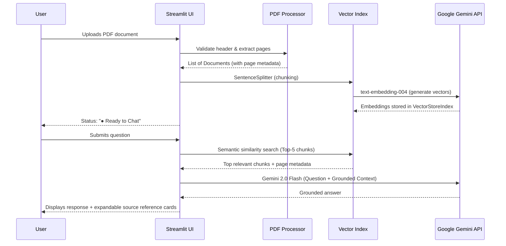

# 📄 AI PDF Research Assistant — Chat with Your Documents

A professional **Retrieval-Augmented Generation (RAG)** application that lets you upload any PDF and have an AI-powered conversation about its contents, complete with page-level source references.


---

## ✨ Features

| Feature | Description |
|---|---|
| 📤 **PDF Upload** | Drag-and-drop or browse for any text-based PDF (up to 50 MB) with format & magic byte validation |
| 📖 **Smart Chunking** | Document pages are parsed with PyMuPDF and split into overlapping chunks for semantic retrieval |
| 🔢 **Vector Embeddings** | Google Gemini `text-embedding-004` converts chunks to high-dimensional embeddings |
| 🔍 **Vector Search** | In-memory similarity search retrieves the top-K most relevant chunks per question |
| 🤖 **AI Chat** | Free-form natural language Q&A powered by Google Gemini 2.0 Flash |
| 📚 **Source References** | Every response displays cited page numbers, relevance scores, and exact text excerpts |
| 🎨 **Modern UI** | Clean, responsive ChatGPT-style Streamlit interface with status badges and conversation reset |
| 🛡️ **Security** | API keys load from `.env` or system environment variables — never hardcoded or exposed in UI |
| 🧪 **Test Suite** | Comprehensive automated unit and integration tests |

---

## 🏗️ Architecture

```
User Question
      │
      ▼
┌─────────────┐    ┌──────────────┐    ┌───────────────┐
│  Streamlit   │───▶│  LlamaIndex  │───▶│ Google Gemini │
│  Frontend    │    │  RAG Engine  │    │ Embeddings +  │
│ (Chat + UI)  │◀───│              │◀───│ 2.0 Flash LLM │
└─────────────┘    └──────┬───────┘    └───────────────┘
                          │
                   ┌──────▼───────┐
                   │ Vector Store │
                   │ (in-memory)  │
                   └──────────────┘
```

---

## 📁 Project Structure

```
API_PROJECT_ML/
├── config/
│   ├── __init__.py
│   └── settings.py          # Centralized configuration, paths, model settings & env loader
├── backend/
│   ├── __init__.py
│   ├── pdf_processor.py     # PDF validation & text extraction per page (PyMuPDF)
│   ├── embeddings.py        # Chunking + Gemini embeddings + VectorStoreIndex
│   └── query_engine.py      # RAG pipeline with grounded answering & source attribution
├── frontend/
│   ├── __init__.py
│   ├── app.py               # Modern SaaS Streamlit app (ChatGPT/Linear-inspired)
│   ├── styles.py            # Dark SaaS theme CSS design system & custom scrollbars
│   └── components.py        # Reusable UI widgets (hero, citations, badges, sidebar profile)
├── utils/
│   ├── __init__.py
│   └── helpers.py           # PDF magic bytes validation, text normalization, hashing
├── tests/
│   ├── __init__.py
│   ├── test_components.py   # Automated unit and integration test suite (12 tests)
│   └── test_ingestion_pipeline.py # End-to-end ingestion & RAG validation test
├── data/
│   └── uploads/             # Temporary uploaded files (git-ignored)
├── main.py                  # Application entry point
├── sample_report.pdf        # 19-page comprehensive test PDF document
├── requirements.txt         # Project dependencies
├── .env.example             # Template for API keys
├── .gitignore               # Ignored files (venv, .env, __pycache__)
└── README.md
```

---

## 🚀 Quick Start

### 1. Clone or Open the Workspace

```bash
cd c:\API_PROJECT_ML
```

### 2. Configure Your API Key

Copy the `.env.example` file to `.env`:

```bash
cp .env.example .env
```

Edit `.env` and paste your Google Gemini API key:

```env
GOOGLE_API_KEY=your_gemini_api_key_here
```

> 🔑 Don't have a key? Get a free key at [Google AI Studio](https://aistudio.google.com/apikey).

*(Alternatively, you can enter your API key directly in the application's sidebar when launched!)*

### 3. Install Dependencies

```bash
pip install -r requirements.txt
```

> *Note for Python 3.14+ on Windows:* If pip encounters binary wheel conflicts for Pillow, install with binary wheels:
> ```bash
> pip install --only-binary :all: pillow grpcio
> pip install --no-deps llama-index-llms-gemini
> pip install -r requirements.txt
> ```

### 4. Run the Automated Tests

Verify that all modules and helper functions work properly:

```bash
python -m unittest tests/test_components.py
```

### 5. Launch the Application

```bash
streamlit run main.py
```

Or run directly with Python:

```bash
python -m streamlit run main.py
```

The application will open in your browser at `http://localhost:8501`.

---

## 🧠 How the RAG Pipeline Works



---

## ⚙️ Configuration Options

All core parameters are organized in [`config/settings.py`](config/settings.py):

| Parameter | Default | Description |
|---|---|---|
| `GEMINI_CHAT_MODEL` | `models/gemini-2.0-flash` | Gemini model for conversational answers |
| `GEMINI_EMBEDDING_MODEL` | `models/text-embedding-004` | Gemini model for vector embeddings |
| `CHUNK_SIZE` | `1024` | Token size for document chunking |
| `CHUNK_OVERLAP` | `128` | Token overlap between adjacent chunks |
| `TOP_K_RESULTS` | `5` | Number of most relevant chunks retrieved per query |
| `MAX_UPLOAD_SIZE_MB` | `50` | Maximum allowable PDF upload size |

---

## 🛡️ Security Best Practices

1. **Environment Variables**: API keys are loaded via `python-dotenv` from `.env` or system environment variables.
2. **Zero Code Exposure**: No secrets or credentials are ever written into source files.
3. **Protected Commits**: `.env` and all uploaded files under `data/uploads/` are excluded by `.gitignore`.
4. **Input Sanitization**: Uploaded files undergo extension validation, magic-byte inspection (`%PDF-`), and size bounds checks before parsing.

---

## 📝 License

This project is licensed under the MIT License.
